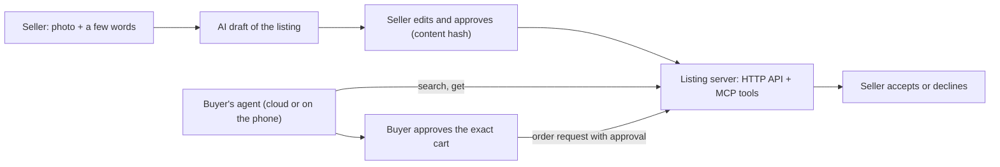

# Agent Commerce: AI ショッピングエージェントのための販売者側リスティング形式

[English](README.md) | 日本語

> ドキュメントおよび仕様ドラフト。リファレンスサーバーと販売者アプリは独自開発で、ソースはこのリポジトリでは公開していません。*Agent Commerce は仮称です。* **ドラフト 0.1: フィールド名は変わる可能性があります。**

**小さな販売者（農家、店舗、個人）が、店舗を運営することなく、人々の AI エージェントに発見され、問い合わせてもらえるための、共通の機械可読リスティング形式です。組み込まれた2つの約束: 販売者は掲載される内容を正確に承認すること、そして両者の合意なしには何も購入されないこと。**

## なぜ
買い物の多くは AI エージェントによって行われるようになります。大手プラットフォームは自社カタログ向けの独自プロトコルを持つでしょう。小さな販売者には、自分の名前で何が言われるかの制御を手放さずに、あらゆるエージェントが読める形で自分の商品を公開するためのシンプルな手段が必要です。

## 2つの約束
1. **販売者は掲載される内容を正確に承認する。** リスティングには `seller_approval.content_sha256` が含まれ、これは販売者が承認した時点のリスティング内容のハッシュです。サーバーは、内容が一致しないリスティングを拒否します。AI が写真からリスティングを起草したとしても、最終的な文章を承認するのは販売者です。
2. **両者の合意なしには何も購入されない。** 注文リクエストには人間のバイヤーの承認（いつ、何を正確に、および任意の支出上限）が含まれている必要があります。リクエストは `awaiting_seller` になるだけで、販売者が受け入れた時点で売買が成立します。

## ここで公開しているもの
| パス | 内容 |
|---|---|
| [`spec/listing.schema.json`](spec/listing.schema.json) | リスティング1件: 商品、数量、価格、在庫状況、fulfillment、出所（事実の取得方法）、販売者承認、ステータス（JSON Schema） |
| [`spec/order-request.schema.json`](spec/order-request.schema.json) | バイヤーのエージェントによるリクエスト（バイヤーの承認付き） |
| [`examples/tomatoes.json`](examples/tomatoes.json) | **架空の**データによる完全なリスティング |
| [`llms.txt`](llms.txt) | このリポジトリを読む AI エージェントとツール向けの短い要約 |

## 仕組み

- **バイヤーのエージェント** は、小さな HTTP API または MCP ツール経由でサーバーにアクセスします: リスティングの検索、リスティング1件の取得、注文リクエスト、ステータス確認。
- **出所（provenance）** は、各事実がどのように得られたか（販売者が入力、モデルが写真から読み取り、その後に編集されたなど）を示すため、エージェントはそれを信頼してよいか人を判断できます。
- **ポケットエージェント** の設計案は、2〜8B のローカルモデルでスマートフォン上で動くほど小さなバイヤーエージェントを検討しています。これにより、その人のリクエストや予算がデバイスから外に出ることはありません。AP2 からマニデートの考え方、A2A から Agent Card による発見の仕組みを借りていますが、いずれの標準も完全に実装していません。

## 状態（正直な版）
| 検証済み | 方法 |
|---|---|
| スキーマ検証、承認ハッシュ、販売者間の分離、バイヤー承認と支出上限、在庫と売り切れ、販売者の判断 | リファレンスサーバーでの8件の単体テスト、2026-10-12 |
| MCP ツールの一覧と呼び出し（search、request） | in-process で呼び出し、2026-10-12 |
| 販売者アプリ: 写真 → AI draft → 承認済みリスティング | 偽のビジョンモデルによる3件のエンドツーエンドテスト |
| デバイス上でのリクエスト解析 | デスクトップ CPU 上の Qwen3.5-4B（スマートフォンの簡易代替）: 3/3 のリクエスト正解、4〜6秒。予算の推測は拒否した |
| **未検証** | |
| クライアントとしての実際のエージェント製品; 販売者アプリでの実際のビジョンモデル; 実際のスマートフォン | 試していない |
| 決済、配送、紛争処理 | 0.1 のスコープ外 |
| 大規模な悪用（スパムリスティング、偽注文） | 販売者ごとのトークンと入力検証以外に対処していない |
| A2A / AP2 スキーマとの互換性 | 考え方は借用; フィールド名は公開済みスキーマに対する確認がまだ |

## 未解決の課題
- 大手プラットフォームが採用するエージェントコマースプロトコルへのアダプター。
- 署名付きリスティング（サーバー保持のハッシュの代わりに公開鍵署名）。リスティングをどこへでもミラーして検証できるようにするため。
- 写真が実際の商品を実際の時刻に写していることの証明。

## フィードバックを求めています
**分かりにくい点、欠けている点、誤りを教えてください**: [フィードバックフォーム](https://github.com/johnknash2025/agent-commerce/issues/new?template=feedback.yml) または [ディスカッション](https://github.com/johnknash2025/agent-commerce/discussions) を使ってください。参考になる質問: あなたなら自分の商品をこの方式で掲載しますか? バイヤーのエージェントに何があれば足りませんか? どのフィールドを必須にすべきですか?

## ライセンス
仕様ファイル（`spec/`）と例（`examples/`）は CC BY 4.0 で提供します。リファレンスサーバーと販売者アプリにはライセンスを付与しません。
