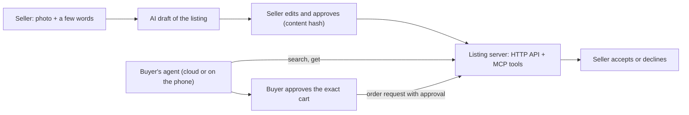

# Agent Commerce: a seller-side listing format for AI shopping agents

> Documentation and specification draft. The reference server and the seller app are proprietary and their source is not published here. *Agent Commerce is a working title.* **Draft 0.1: field names may still change.**

**A common, machine-readable listing format that lets a small seller (a farm, a shop, a person) be found and asked by people's AI agents, without running a storefront, and with two promises built in: the seller approves exactly what is listed, and nothing is bought unless both people agree.**

## Why
More shopping will be done by AI agents. Large platforms will have their own protocols for their own catalogues. Small sellers need a simple way to publish what they have, in a form any agent can read, without giving up control of what is said in their name.

## The two promises
1. **The seller approves exactly what is listed.** A listing carries `seller_approval.content_sha256`, a hash of the listing content at the moment the seller approved it. A server rejects a listing whose content does not match. If an AI drafted the listing from a photo, the seller still approves the final text.
2. **Nothing is bought without both people agreeing.** An order request must carry the human buyer's approval (when, what exactly, and an optional spending cap). It only becomes `awaiting_seller`; the sale happens when the seller accepts.

## What is published here
| Path | What |
|---|---|
| [`spec/listing.schema.json`](spec/listing.schema.json) | One listing: item, quantity, price, availability, fulfillment, provenance (how the facts were obtained), seller approval, status (JSON Schema) |
| [`spec/order-request.schema.json`](spec/order-request.schema.json) | A buyer agent's request, with the buyer's approval |
| [`examples/tomatoes.json`](examples/tomatoes.json) | A complete listing with **invented** data |
| [`llms.txt`](llms.txt) | A short summary for AI agents and tools that read this repository |

## How it fits together

- **Buyer agents** reach a server through a small HTTP API or MCP tools: search listings, get one listing, request an order, check its status.
- **Provenance** says how each fact was obtained (typed by the seller, read from a photo by a model, edited afterwards), so an agent can tell the person how much to trust it.
- A **pocket agent** design explores a buyer agent small enough to run on a phone with a 2-8B local model, so the person's requests and budget never leave the device. It borrows the idea of mandates from AP2 and discovery through an Agent Card from A2A; it does not implement either standard in full.

## Status (honest version)
| Verified | How |
|---|---|
| Schema validation, approval hash, seller isolation, buyer approval and spending cap, stock and sell-out, seller decisions | 8 unit tests on the reference server, 2026-10-12 |
| MCP tools list and call (search, request) | called in-process, 2026-10-12 |
| Seller app: photo → AI draft → approved listing | 3 end-to-end tests with a fake vision model |
| On-device request parsing | Qwen3.5-4B on a desktop CPU as a rough phone stand-in: 3 of 3 requests correct, 4-6 s; it refused to guess a budget |
| **Not verified** | |
| A real agent product as the client; a real vision model in the seller app; real phones | not tried |
| Payments, delivery, disputes | out of scope for 0.1 |
| Abuse at scale (spam listings, fake orders) | not addressed beyond per-seller tokens and input validation |
| Compatibility with A2A / AP2 schemas | ideas borrowed; field names not yet checked against the published schemas |

## Open questions
- Adapters to the agent-commerce protocols that large platforms adopt.
- Signed listings (public-key signatures instead of a server-held hash), so listings can be mirrored and verified anywhere.
- Proof that a photo shows a real item at a real time.

## Feedback wanted
**Tell me what is unclear, missing or wrong**: use the [feedback form](https://github.com/johnknash2025/agent-commerce/issues/new?template=feedback.yml) or start a [discussion](https://github.com/johnknash2025/agent-commerce/discussions). Useful questions: Would you list your goods this way? What would a buyer's agent need that is missing? Which fields should be required?

## License
The specification files (`spec/`) and the example (`examples/`) are offered under CC BY 4.0. No license is granted for the reference server or the seller app.
